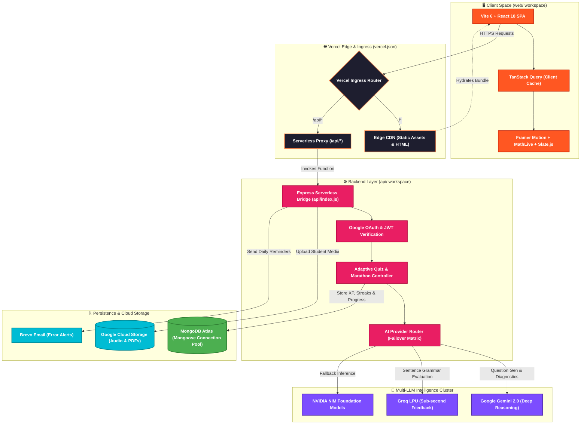
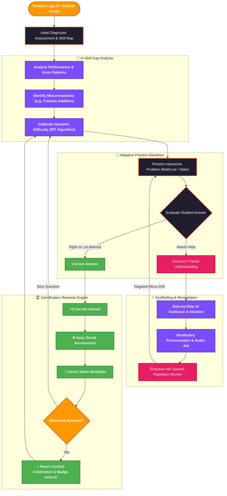
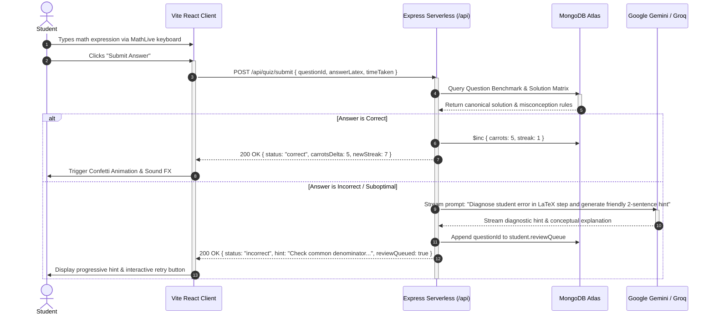

<div align="center">

# MetaSkills

> **Adaptive, Gamified AI Learning Platform for K-12 and Competitive Academic Mastery**

[](https://metaskills.site)
[](https://github.com/jimfleax/MetaSkills/actions)
[](LICENSE)
[](https://github.com/jimfleax/MetaSkills/releases)
[](https://github.com/jimfleax/MetaSkills/pulls)

<p align="center">
  <a href="#-quick-start"><b>Quick Start</b></a> •
  <a href="#-system-architecture"><b>Architecture</b></a> •
  <a href="#-tech-stack-matrix"><b>Tech Stack</b></a> •
  <a href="#-pedagogy--gamification-engine"><b>Pedagogy & Gamification</b></a> •
  <a href="#-interactive-api-catalog"><b>API Specs</b></a> •
  <a href="#-environment-variables-specification"><b>Environment</b></a> •
  <a href="#-deployment-topology"><b>Deployment</b></a> •
  <a href="https://metaskills.site"><b>Live Demo 🌐</b></a>
</p>

</div>

---
## 🌟 Platform Overview

**MetaSkills** is an adaptive, gamified AI learning platform built for students in Grades 3–12 and academic educators. It harmonizes a vibrant, dopamine-driven gamification economy (the **Carrot 🥕 Currency System**, daily streaks, spaced repetition, and celebratory milestones) with rigorous academic instrumentation:
* **Interactive Mathematical Typesetting:** Virtual equation keypads and symbolic verification using **MathLive**, **KaTeX**, and computer algebra systems (**Algebrite** & **MathJS**).
* **AI-Powered Syntactic & Writing Coaching:** Sub-second grammar analysis and sentence diagnostics orchestrated across **Google Gemini**, **Groq LPU (Llama-3.1)**, and **NVIDIA NIM**.
* **Adaptive Difficulty Scaling:** Real-time **Elo rating engine** ($K=32$) with logistic sigmoid difficulty mapping ($0 - 100$) dynamically calibrating problem sets to each student's mastery zone.
* **Leitner Spaced Repetition (SRS):** 7-box memory retention cycle with cognitive daily acquisition throttles.
* **Production-Grade Monorepo Architecture:** Dual-mode **Express 5** backend (supporting both local stateful containers and zero-cold-start **Vercel Serverless Functions**) paired with a high-performance **React 18 + Vite 6 Single Page Application & PWA**.

---

## 🎨 Feature Showcase

<table width="100%">
  <tr>
    <td width="50%" valign="top">
      <h3>📐 Adaptive Math Marathon</h3>
      <ul>
        <li>Interactive <b>MathLive</b> LaTeX equation editor & tactile on-screen keypad.</li>
        <li>Symbolic algebra engine evaluating polynomial roots, fractions, and systems of equations.</li>
        <li>Instant step-by-step misconception diagnostics with progressive hints.</li>
        <li>Dynamic difficulty scaling using real-time Elo rating calibration.</li>
      </ul>
    </td>
    <td width="50%" valign="top">
      <h3>📖 Reading Comprehension & Passages</h3>
      <ul>
        <li>Rich-text passage reader powered by an AST <b>Slate.js</b> engine.</li>
        <li>Dynamic inline cloze tests (fill-in-the-blanks) with interactive token blanks.</li>
        <li>Interactive <b>AudioWord</b> pronunciation with 3-tier speech synthesis fallback.</li>
        <li>Contextual reading analysis measuring reading speed vs. comprehension accuracy.</li>
      </ul>
    </td>
  </tr>
  <tr>
    <td width="50%" valign="top">
      <h3>✍️ AI Grammar & Sentence Coach</h3>
      <ul>
        <li>Real-time sentence validation powered by <b>Groq LPU + Llama-3.1</b> and <b>Google Gemini</b>.</li>
        <li>Natural language token tagging via <b>Compromise NLP</b> (parts of speech, tenses, verb forms).</li>
        <li>30-word synthesis challenge evaluating semantic precision and vocabulary retention.</li>
        <li>Automated failover matrix across AI providers preventing session interruptions.</li>
      </ul>
    </td>
    <td width="50%" valign="top">
      <h3>🏆 Dopamine-Driven Gamification</h3>
      <ul>
        <li><b>The Carrot (🥕) Economy:</b> Balanced token incentives for accuracy, streaks, and module mastery.</li>
        <li>Rolling 7-day UTC-normalized earning history with week-over-week comparison charts.</li>
        <li>Full-screen celebration modal with animated arithmetic breakdowns and confetti physics.</li>
        <li>Comprehensive analytics with 5 specialized <b>Chart.js</b> diagnostic visualizers.</li>
      </ul>
    </td>
  </tr>
</table>

---

## 🏛️ System Architecture

MetaSkills is architected as an enterprise-grade, serverless monorepo optimized for seamless Vercel edge deployment, resilient MongoDB connection pooling, and multi-cloud AI orchestration.

### 1. Production Topology & Serverless Monorepo Architecture



---

### 2. Gamified Pedagogical Learning Loop (Student Journey)



---

### 3. Real-Time AI Question Evaluation Sequence



---

<details>
<summary><b>🔬 Click to expand Deep-Dive: Architectural Hardening & Patterns</b></summary>
<br>

### 1. Resilient Serverless Connection Lifecycle (`api/config/database.js`)
* **`globalThis` Singleton Cache:** Prevents socket exhaustion during Vercel lambda freeze/thaw cycles (`globalThis.__metaSkillsMongooseCache`).
* **Single-Flight Coalescing:** Concurrently arriving requests share a single in-flight connection promise (`cache.promise`), eliminating connection stampedes on MongoDB Atlas during cold starts.
* **Exponential Backoff with Full Jitter:** 3 retries with randomized backoff:
  $$T_{\text{delay}} = \text{random}(0, \min(T_{\text{init}} \cdot 2^{\text{attempt}-1}, T_{\text{max}})) + 50\text{ms}$$
* **Dynamic Connection Pool Tuning:** Automatically sets `maxPoolSize: 2`, `minPoolSize: 0`, and `serverSelectionTimeoutMS: 3000` when running under Vercel Serverless (`process.env.VERCEL`), scaling to `maxPoolSize: 10` in stateful containers.
* **Automatic IPv4 Fallback:** Catches `ETIMEDOUT` and `ENETUNREACH` socket errors (common with cloud IPv6 routing anomalies) and automatically retries with `{ family: 4 }`.
* **Credential Masking:** Passwords in database URIs are automatically redacted (`maskMongoUri`) in all logs and error traces.

### 2. Distributed Idempotency Guard (`api/middlewares/idempotency.js`)
* Mutating endpoints (`/api/quiz/submit`, `/api/quiz/response`, `/api/vocabulary/verify`, `/api/genai/sentences/evaluate`, `/api/errors/report`) are protected by cryptographic idempotency tokens.
* Scoped by `userId + X-Idempotency-Key` paired with a **SHA-256 payload hash** to reject tampering.
* In-flight collisions return `425 (Too Early)`; replays return the cached response immediately. Cleaned up via 6-hour MongoDB TTL indexes.

### 3. Stateless Cryptographic Question Tokens
* Dynamically generated questions (procedural Math sums, Grammar token clicks, Reading Passage blanks) encode their answer keys and seed parameters into signed, short-lived **HMAC SHA-256 (HS256) JWTs**.
* Allows high-concurrency practice marathons with minimal database writes.

</details>

---

## 🛠️ Tech Stack Matrix

| Domain | Technologies & Badges | Architectural Role & Implementation |
| :--- | :--- | :--- |
| **Frontend SPA** | [](https://react.dev/) [](https://vitejs.dev/) [](https://styled-components.com/) | React 18.3 with Vite 6, styled-components CSS-in-JS design tokens, code-splitting vendor chunks, and PWA service worker. |
| **State & Cache** | [](https://tanstack.com/query) [](https://tanstack.com/virtual) | Declarative asynchronous server state caching, background invalidation, and virtualized list rendering. |
| **UI & Animation** | [](https://www.framer.com/motion/) [](https://www.radix-ui.com/) [](https://github.com/alampros/react-confetti) | Accessible primitives, layout animations, drag-and-drop curriculum ordering (`Reorder.Group`), and celebration physics. |
| **STEM & Editor** | [](https://cortexjs.io/mathlive/) [](https://slatejs.org/) | On-screen virtual math keypad, KaTeX formula rendering, and custom AST rich-text question authoring. |
| **Backend API** | [](https://nodejs.org/) [](https://expressjs.com/) [](https://vercel.com/docs/functions) | Express 5 async pipeline running as a stateless Vercel Serverless function (`api/index.js`) or local daemon (`server.js`). |
| **Database & ODM** | [](https://www.mongodb.com/atlas) [](https://mongoosejs.com/) | Connection pool coalescing, 3-retry jitter, schema validation, compound indexes, and TTL session invalidation. |
| **AI Intelligence** | [](https://ai.google.dev/) [](https://groq.com/) [](https://www.nvidia.com/) | Resilient multi-provider AI adapter with automatic failover, streaming generation, and vision-assisted explanations. |
| **Math & NLP** | [](http://algebrite.org/) [](https://mathjs.org/) [](https://compromise.cool/) | Symbolic algebra equality, polynomial root factoring, and real-time part-of-speech linguistic tagging. |
| **Auth & Security** | [](https://developers.google.com/identity) [](https://jwt.io/) [](https://owasp.org/) | Google One-Tap authentication, HS256-pinned JWTs, double-submit cookie CSRF protection, and rate limiting. |
| **Storage & Comms** | [](https://cloud.google.com/storage) [](https://www.brevo.com/) | V4 signed direct-to-cloud upload URLs for question media and error screenshots; Brevo AI error alerts. |
| **DevOps & PM** | [](https://pnpm.io/) [](https://eslint.org/) [](https://prettier.io/) | Monorepo workspace orchestration (`only-allow pnpm`), ESLint flat configs, and multi-server bash runner. |

---

## 📂 Monorepo Structure

```
MetaSkills/
├── api/                           # Express 5 Serverless API workspace
│   ├── api/index.js               # Vercel Serverless Function entry point
│   ├── server.js                  # Stateful server listener (Port 7860) with graceful teardown
│   ├── express.js                 # Express application pipeline & middleware configuration
│   ├── config/
│   │   ├── database.js            # Enterprise connection engine (pooling, jitter, IPv4 fallback)
│   │   ├── env.js                 # Environment variable validation & fallback loader
│   │   └── scripts.registry.js    # Secure whitelist registry for migration/maintenance scripts
│   ├── controllers/               # 18 Modular controllers (auth, quiz, math, vocabulary, etc.)
│   ├── models/                    # Mongoose schemas (User, Question, Module, Responses, etc.)
│   ├── routes/                    # Route endpoints with rate limiting & permission guards
│   ├── services/                  # Business logic, AI adapters, math engines, and SRS
│   ├── middlewares/               # Auth, CSRF, idempotency, client block, and error handlers
│   ├── tests/                     # Jest ESM unit & integration test suites
│   ├── Dockerfile                 # Production Alpine-based container definition
│   └── docker-compose.yml         # Containerized development orchestrator
│
├── web/                           # Vite 6 + React 18 SPA workspace
│   ├── index.html                 # PWA shell with preloaded fonts and meta headers
│   ├── vite.config.js             # Vite bundler, proxy configuration & chunking rules
│   ├── public/
│   │   ├── sw.js                  # Service Worker with Cache-First assets & /api bypass
│   │   └── manifest.json          # PWA configuration
│   └── src/
│       ├── main.jsx               # React entry point, QueryClient & SW updater
│       ├── App.jsx                # Router configuration & dynamic route wrappers
│       ├── components/            # Reusable UI widgets, MathField, Slate editor, Cards
│       ├── pages/                 # Full-screen pages (Dashboard, Marathon, Analytics, Admin)
│       ├── context/               # React contexts (SessionProvider, AdminAuthProvider)
│       ├── hooks/                 # Custom reactive hooks (useSpeech, useApi, useAdminAuth)
│       ├── services/              # Same-origin Axios client, CSRF handling & LRU cache
│       ├── styles/                # GlobalStyles.jsx, theme tokens & keyframe animations
│       └── utils/                 # PDF extraction (pdfjs + Tesseract OCR) & formatters
│
├── test/                          # Cross-boundary end-to-end testing suite (Playwright)
├── docs/                          # Single source of truth for architectural documentation
├── run.sh                         # Multi-service interactive bash runner with colored logs
├── vercel.json                    # Monorepo multi-service routing and rewrite rules
├── package.json                   # Root monorepo coordinator (pnpm workspaces)
├── pnpm-workspace.yaml            # Monorepo workspace definitions and build permissions
└── .env.example                   # Unified environment variable template
```

---

## 🎯 Pedagogy & Gamification Engine

### 1. The Carrot (🥕) Economy
Carrots represent student progress and consistency:
* **Standard Curriculum Question:** $+5$ Carrots upon correct answer.
* **Module Mastery Completion:** $+50$ Carrot bonus multiplier.
* **Procedural Math Sum:** $+2$ Carrots per verified solution.
* **Vocabulary Recall:** $+2$ Carrots per Leitner box progression.
* **Sentence Composition Challenge:** $1 - 10$ Carrots awarded dynamically based on AI evaluation score.
* **Rolling 7-Day History:** The `User.carrots.history` array automatically tracks daily earnings normalized to UTC midnight, shifting records forward seamlessly as calendar days elapse.

### 2. Spaced Repetition System (Leitner SRS)
Vocabulary learning is managed using an algorithmic 7-box Leitner progression:
* **Review Schedule:** Box 0 (10 mins) $\rightarrow$ Box 1 (1 day) $\rightarrow$ Box 2 (3 days) $\rightarrow$ Box 3 (7 days) $\rightarrow$ Box 4 (14 days) $\rightarrow$ Box 5 (30 days) $\rightarrow$ Box 6 (60 days).
* **Cognitive Load Protection:** Limits new words to **20 words per 24-hour cycle**. If a student reaches the cap with no reviews due, the system gracefully recommends practicing sentence composition instead.
* **AI Sentence Production Gate:** Words become eligible for generative AI sentence practice only after reaching **Box 2 or higher**, ensuring foundational comprehension precedes active composition.

### 3. Adaptive Elo Rating & Sigmoid Difficulty Scaling
Student ability and question complexity are modeled on a shared continuous Elo scale ($K=32$):
* **Expected Score:**
  $$E_{\text{user}} = \frac{1}{1 + 10^{(R_{\text{question}} - R_{\text{user}}) / 400}}, \quad E_{\text{question}} = 1 - E_{\text{user}}$$
* **Standardized Difficulty Metric:**
  $$\text{displayDifficulty} = \text{round}\left( \frac{1}{1 + e^{-(R - 1200) / 400}} \times 100 \right)$$
  Classified into intuitive bands: **Easy** ($\le 35$), **Medium** ($36 - 60$), **Hard** ($61 - 80$), and **Very Hard** ($> 80$).

---

### 🎮 Pedagogical Feature Matrix & Quest Log

- [x] **🎓

## 🚀 Quick Start

### Prerequisites
* **Node.js:** `>= 20.10.0` (LTS recommended)
* **pnpm:** `12.18.0` (or `pnpm >= 10.x`)
* **MongoDB:** A running local instance or free cluster on [MongoDB Atlas](https://www.mongodb.com/atlas)

### 1. Installation

```bash
# Clone repository
git clone https://github.com/jimfleax/MetaSkills.git
cd MetaSkills

# Install dependencies across all workspaces (strictly enforced via only-allow pnpm)
pnpm install
```

### 2. Configure Environment

Copy the unified environment template:
```bash
cp .env.example .env
```
*(The root `.env` is automatically read by both backend and frontend via Vite's `envDir: ".."`).*

### 3. Run Development Servers

#### Option A: Unified Concurrent Runner (Recommended)
```bash
# Starts both Express (7860) and Vite (5173) concurrently
pnpm run dev

# OR run with pre-run lint checks and colored prefixed logs:
./run.sh --lint
```

#### Option B: Independent Workspaces
```bash
# Terminal 1 - Express Backend
pnpm run dev:api
# Listening on http://localhost:7860

# Terminal 2 - Vite React Frontend
pnpm run dev:web
# Listening on http://localhost:5173
```

Visit **`http://localhost:5173`** in your browser. All `/api` requests are automatically proxied to the backend at port 7860.

#### Option C: Containerized API Execution (Docker)
```bash
cd api
docker-compose up --build
```

---

<details>
<summary><b>🔐 Click to expand Full Environment Variables Specification (`.env`)</b></summary>
<br>

| Variable Name | Scope | Required | Sensitivity | Default / Example | Purpose / Description |
| :--- | :--- | :---: | :---: | :--- | :--- |
| `PORT` | `api` | Optional | Low | `7860` | HTTP port for stateful Express backend listener in local and Docker environments. |
| `NODE_ENV` | `api`, `web` | Optional | Low | `development` | Runtime mode (`development`, `production`, `test`). Governs cookie security and error details. |
| `MONGODB_URI` | `api` | **Yes** | **High** | `mongodb+srv://...` | MongoDB connection string (Atlas or local). Single-flight cached and retried with full jitter. |
| `JWT_SECRET` | `api` | **Yes** | **Critical** | `your_jwt_signing_secret` | Secret key used to sign and verify JSON Web Tokens (enforced with HS256 algorithm pinning). |
| `CORS_ORIGIN` | `api` | Optional | Low | `https://metaskills.site` | Comma-separated list of additional allowed origins for CORS and client validation. |
| `GOOGLE_CLIENT_ID` | `api` | **Yes** | Medium | `...apps.googleusercontent.com` | Google OAuth 2.0 Web Client ID used by backend `google-auth-library` to verify ID tokens. |
| `GOOGLE_CLIENT_SECRET` | `api` | Optional | **High** | `your_secret` | Google OAuth client secret for backend token exchange. |
| `GEMINI_API_KEY` | `api` | Optional | **High** | `AIzaSy...` | API key for Google Gemini SDK (`@google/genai`) to generate questions and explanations. |
| `GROQ_API_KEY` | `api` | Optional | **High** | `gsk_...` | API key for Groq Cloud API for ultra-low-latency Llama-3 inference. |
| `NVIDIA_API_KEY` | `api` | Optional | **High** | `nvapi-...` | API key for NVIDIA NIM API (Mistral, Qwen models). |
| `BREVO_API_KEY` | `api` | Optional | **High** | `xkeysib-...` | API key for Brevo transactional email delivery (notifications, error reports). |
| `GCS_BUCKET_NAME` | `api` | Optional | Medium | `metaskills-assets` | Primary Google Cloud Storage bucket for question media and documents. |
| `GCS_SCREENSHOT_BUCKET_NAME`| `api` | Optional | Medium | `metaskills-screenshots`| GCS bucket for user screenshot and bug report uploads. |
| `GOOGLE_APPLICATION_CREDENTIALS` | `api` | Optional | **High** | `./gcs-key.json` | Path to Google Service Account JSON key for GCS storage access. |
| `GOOGLE_DRIVE_FOLDER_ID` | `api` | Optional | Medium | `1AbCd...` | Google Drive folder ID for automated database backup dumps. |
| `GOOGLE_REFRESH_TOKEN` | `api` | Optional | **High** | `1//04...` | OAuth refresh token for Google Drive backup automation. |
| `VITE_GOOGLE_CLIENT_ID`| `web` | **Yes** | Medium | `...apps.googleusercontent.com` | Google Client ID exposed to client-side Google OAuth library in the browser. |

</details>

---

## 📡 Interactive API Catalog

<details>
<summary><b>Click to expand the REST API Endpoint Registry</b></summary>
<br>

### 1. Authentication & Student Profile (`/api/users`)
* `POST /api/users/google-auth` - Authenticates student via Google ID token, issues `authToken` HTTP-only cookie.
* `PUT /api/users/complete-profile` - Selects student grade (1–12) during mandatory onboarding.
* `GET /api/users/getProfile` - Returns student profile, daily carrot progress, and current streak.
* `GET /api/users/carrots` - Fetches current carrot balance and rolling 7-day earning history.
* `GET /api/users/streaks` - Records daily attendance and returns calendar week bitmask.
* `GET /api/users/performance` - Computes percentage progress and accuracy across completed modules.
* `POST /api/users/deleteSession` - Clears session record and wipes session cookies.

### 2. Adaptive Quiz & Marathon Engine (`/api/quiz`)
* `POST /api/quiz/modules/start` - Validates sequential module unlocking; returns first question.
* `POST /api/quiz/submit` - Submits module answer; awards carrots, updates progress, and recalculates Elo asynchronously (idempotent).
* `POST /api/quiz/response` - Verifies stateless cryptographic question token for marathon modes.
* `GET /api/quiz/analytics/daily` - Daily question volume and accuracy over time.
* `GET /api/quiz/analytics/speed-accuracy` - Correlation curve between question duration and correctness.
* `GET /api/quiz/analytics/skills` - Mastery breakdown by tagged curriculum skill.
* `POST /api/quiz/bulk-import` - (Admin) Transactional bulk question importer from JSON.

### 3. Procedural Mathematics Engine (`/api/math`)
* `GET /api/math/topics` - Hierarchical mathematical category tree (Arithmetic, Algebra, Geometry, Calculus).
* `GET /api/math/question` - Procedurally generates arithmetic or algebraic problem; returns signed JWT.
* `POST /api/math/answer` - Stateless verification of student answer using computer algebra system (Algebrite/Mathjs).

### 4. Vocabulary & Spaced Repetition (`/api/vocabulary`)
* `GET /api/vocabulary/quiz` - Serves next scheduled SRS recall word (or new word if under 20/day cap).
* `POST /api/vocabulary/verify` - Evaluates recall; updates Leitner box (0–6) and next review timestamp.
* `POST /api/vocabulary/bulk` - (Admin) Ingests multi-line `word - definition` text lists.

### 5. Generative AI Services (`/api/genai`)
* `POST /api/genai/sentences/evaluate` - Evaluates student sentence composition for vocabulary retention and syntax.
* `POST /api/genai/explanation` - Generates multi-modal, step-by-step pedagogical explanations.
* `POST /api/genai/tts` - Converts text to speech using Groq Orpheus v1 (returns Base64 WAV stream).
* `POST /api/genai/parse-questions` - (Admin) Extracts structured questions from unformatted PDF text using Gemini.

### 6. System Probes & Diagnostics
* `GET /healthz/live` - Process liveness probe returning uptime.
* `GET /healthz/ready` - Readiness probe executing database ping; returns 503 during teardown.
* `GET /api/csrf-token` - Generates fresh double-submit CSRF cookie token.

</details>

---

## 🌐 Deployment Topology

The monorepo is configured for unified deployment on **Vercel** via root and workspace `vercel.json` configurations:

```json
{
  "$schema": "https://openapi.vercel.sh/vercel.json",
  "services": {
    "api": {
      "root": "api",
      "framework": "express"
    },
    "web": {
      "root": "web",
      "framework": "vite",
      "outputDirectory": "dist",
      "rewrites": [{ "source": "/(.*)", "destination": "/index.html" }]
    }
  },
  "rewrites": [
    { "source": "/api/(.*)", "destination": { "service": "api" } },
    { "source": "/(.*)", "destination": { "service": "web" } }
  ]
}
```

### Key Deployment Guarantees
1. **Same-Origin Route Consolidation:** Requests matching `/api/(.*)` route to `api/api/index.js`, while all other requests serve the static Vite React SPA from `web/dist/`. No cross-origin headers are required in production!
2. **Serverless Connection Caching:** Global connection pooling keeps Mongoose connected across warm lambda invocations.
3. **PWA Service Worker Bypass:** `web/public/sw.js` explicitly intercepts and bypasses all `/api/*` paths to ensure real-time dynamic data and cookies pass untouched.

---

## 🛡️ Quality Assurance & Testing Pipeline

```bash
# Run backend Jest test suite with in-memory MongoDB
pnpm run test

# Run ESLint flat config across all workspaces
pnpm run lint

# Build frontend production bundle with Rollup chunk splitting
pnpm run build
```

* **Backend Testing:** Jest v30 executed in native ESM mode (`NODE_OPTIONS=--experimental-vm-modules jest --runInBand --detectOpenHandles`). Tests against an ephemeral in-memory MongoDB instance (`mongodb-memory-server`), validating single-flight connection coalescing, retry backoffs, cascade deletions, and controller idempotency.
* **Frontend Verification:** ESLint 9 Flat Config with React and React Hooks rules ensuring zero lint errors.
* **End-to-End Suite:** Playwright tests in `test/` featuring authenticated session state fixtures (`test/.auth/user.json`).

---

## 📄 License & Attribution

Distributed under the **ISC / MIT License**. See `LICENSE` for more information.

<div align="center">

Made with ❤️ by **Reetabrata Bhandari**

</div>
